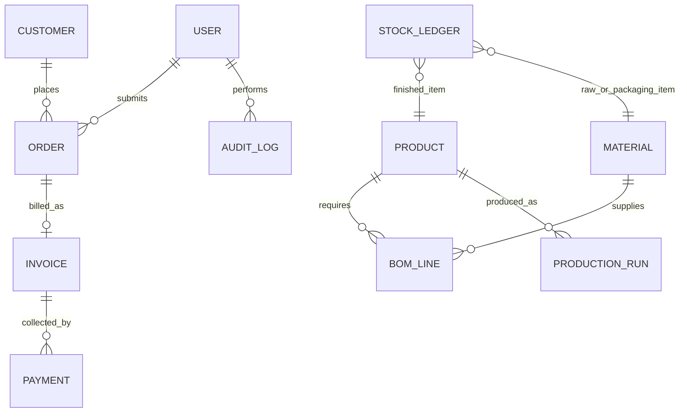

# UdyamFlow design note

## Data model

`StockLedger` is append-only. A row is a signed quantity in the item's canonical base unit and names its source type, source document ID, label and creating user. The live balance is a sum of ledger quantities, converted back into the item's display unit for the UI. Opening stock is a seeded ledger movement. Purchases, production consumption/output and dispatch all append ledger rows within a MongoDB transaction. Per-item lock documents make concurrent postings serialize so two dispatches cannot both consume the same available balance.

Products snapshot order prices and invoice line details so that later master-data changes do not rewrite posted history. A posted invoice carries the recipient/state snapshot, HSN, taxable paise and tax split. Payments link to one invoice and cannot exceed its remaining balance. Production records planned and actual quantities for each BOM item, output/yield variance, direct overheads and material/run costs. Audit events identify the user, action and source entity.

## Decisions and assumptions

- **MERN / deployability:** React + Vite, Express + Node.js and MongoDB/Mongoose. Compose starts MongoDB as a single-node replica set because production, invoice and dispatch posting need multi-document transactions.
- **Inventory units:** quantities are normalized to grams, millilitres, pieces, packets or cartons. The UI and BOM preserve familiar input/display units. Incompatible conversions fail validation.
- **Money/tax:** monetary totals use integer paise. Tax is rounded per invoice line; intrastate tax is split into CGST/SGST, and interstate tax is IGST. Demo supplier GSTIN and e-invoice are illustrative only.
- **Valuation/costing:** moving weighted-average unit cost derives from signed ledger movements. Direct labour and gas/power are assigned wholly to the production run. The benchmark estimates ₹31.14 per good packet.
- **Orders and shortage:** admin can approve a shortage-flagged order to preserve the benchmark review flow, but cannot dispatch more finished goods than are available. An order can be revised or replenished before dispatch.
- **Offline capture:** the app shell is cached by a service worker in production. Sales orders submitted without connectivity are stored locally with an idempotency key and sync on reconnect. Local queued orders remain on that browser/device.
- **Access:** server middleware enforces roles independently of the React route/menu. Accountants have read-only operational/report access except recording payments; salesmen see only their own orders.
- **Cancellation and scope gaps:** an unpaid, undispatched invoice is cancelled by a numbered credit note; paid or dispatched invoices require a separate refund/return workflow. Partial dispatch/returns, supplier master management, Tally/e-invoice integration, batch/expiry tracking and GPS route logs are not included.
