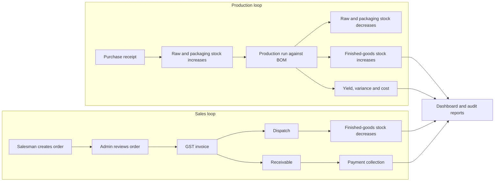

# UdyamFlow

UdyamFlow is a MERN application for a small packaged South Indian snacks factory. It records a transaction once, at its source, and carries that transaction through stock, production, GST billing, payment collection, costing and audit reports.

It is built around two connected business loops:



## What the application does

- Captures mobile-friendly salesman orders, including offline storage and later sync.
- Lets admins review orders, flag shortages, issue GST invoices and record dispatch.
- Lets production staff receive materials and post BOM-based production runs.
- Maintains an append-only, source-linked inventory ledger rather than editable stock balances.
- Calculates consumption variance, yield variance, moving-average material cost and cost per packet.
- Records invoice payments and outstanding receivables.
- Exports sales, GST, stock, production, purchase, outstanding and order reports as CSV or PDF.

## Quick start - Windows, without Docker

### Requirements

- Node.js 20 or newer.
- MongoDB Community Server installed. MongoDB Compass alone is not enough because the application needs the `mongod` executable.

### First start

Open PowerShell in the project directory and run:

```powershell
cd C:\Users\Public\projects\UdyamFlow
Copy-Item server\.env.example server\.env
npm install
npm run start:demo
```

`start:demo` completes all first-run work automatically:

1. Starts UdyamFlow's local MongoDB daemon on port `27018` when needed.
2. Initializes the required single-node replica set named `rs0`.
3. Seeds demo users, materials, products, BOMs, customers and opening stock.
4. Starts the Express API and React frontend together.

Open http://localhost:5173. The API health endpoint is http://localhost:4000/api/health.

The app uses port `27018` to avoid a conflict with a normal standalone MongoDB Windows service on port `27017`. Its local data files are stored in `.data/mongodb` and ignored by Git.

### Later starts

After the first seed, run only:

```powershell
npm run dev
```

- Frontend: http://localhost:5173
- Backend API: http://localhost:4000

To add new seed data introduced by a code update, run `npm run seed`.

### npm esbuild warning

If npm blocks the `esbuild` install script, approve it once and reinstall. Vite needs it to run:

```powershell
npm install-scripts approve esbuild
npm install
```

### Local environment settings

`server/.env` is intentionally not committed. Its useful local settings are:

```dotenv
PORT=4000
MONGODB_URI=mongodb://127.0.0.1:27018/udyamflow?replicaSet=rs0
JWT_SECRET=replace-this-with-a-long-random-secret
CLIENT_ORIGIN=http://localhost:5173
AUTO_START_MONGO=true
```

If MongoDB is installed outside the usual Windows location, set its full executable path:

```dotenv
MONGOD_BINARY=C:\Program Files\MongoDB\Server\8.2\bin\mongod.exe
```

For MongoDB Atlas, a company database server, or Docker, set `AUTO_START_MONGO=false` and provide the appropriate `MONGODB_URI`.

## Demo accounts

Every seeded account uses the password `demo1234`.

- Admin: `admin@udyamflow.demo`
- Salesman A: `sales.a@udyamflow.demo`
- Salesman B: `sales.b@udyamflow.demo`
- Production supervisor: `production@udyamflow.demo`
- Accountant: `accountant@udyamflow.demo`
- Owner: `owner@udyamflow.demo`

Change these credentials and the JWT secret before any real deployment.

## Roles and screens

### Salesman

The salesman uses **Orders** on a phone or desktop.

1. Selects a customer.
2. Adds one or more finished products and packet quantities.
3. Submits the order to the factory.
4. Tracks only their own orders as submitted, approved, invoiced or dispatched.
5. When offline, the browser stores the order with an idempotency key and syncs it after reconnecting.

### Admin

The admin controls the sales workflow.

1. Opens the incoming order queue.
2. Reviews stock availability, price and quantity.
3. Edits, approves or rejects a submitted order; edits are audited.
4. Creates a GST invoice for an approved order.
5. Dispatches an order only when sufficient finished goods exist.
6. Records payments and reviews invoices, credit notes, stock and reports.

### Production supervisor

The production user works with **Purchases** and **Production**.

1. Records raw-material and packaging receipts.
2. Selects a product and its BOM.
3. Enters actual material issues, good output, damaged pouches, cartons used, labour and utilities.
4. Posts one transaction that updates inventory, cost and variance together.

### Accountant and owner

The accountant has read access to operations and reports, and can record payments. The owner sees the dashboard summary: orders, low-stock alerts, recent production, sales value and outstanding dues. Server-side roles prevent users from calling actions outside their permissions.

## Product catalogue and BOMs

The seed data includes four finished snacks. Each product has its own SKU, price, HSN code, GST rate, expected batch yield, packaging and BOM.

### Murukku - 200 g

- SKU `MRK-200`; price ₹50 before GST; expected output 200 packets per batch.
- BOM: flour, cooking oil, salt and spice mix, 200 g pouches and cartons.
- This remains the default production product because it is the required benchmark scenario.

### South Indian Mixture - 200 g

- SKU `MIX-200`; price ₹55 before GST; expected output 200 packets per batch.
- BOM: besan, peanuts, rice flakes, cooking oil, spice mix, 200 g pouches and cartons.

### Banana Chips - 150 g

- SKU `BNC-150`; price ₹60 before GST; expected output 200 packets per batch.
- BOM: raw banana, coconut oil, spice mix, 150 g pouches and 150 g cartons.

### Mysore Pak - 250 g

- SKU `MSP-250`; price ₹90 before GST; expected output 160 packets per batch.
- BOM: besan, sugar, ghee, 250 g pouches and 250 g cartons.

Opening stock exists for every seeded ingredient, packaging item and finished product. Admins can also add their own materials, customers, products and BOMs from **Master data**.

## Detailed workflow

### 1. Purchase receipt

Use **Purchases** to select a material, supplier, quantity, unit and price. Posting a receipt:

1. Creates a unique `PUR-` purchase document.
2. Adds a positive source-linked movement to the stock ledger.
3. Stores the supplier, user, time and unit cost.
4. Increases available stock immediately.
5. Includes the receipt price in the material's moving weighted-average valuation.

### 2. Production from a BOM

Use **Production** to choose a product and record a batch. The screen starts from the selected product's BOM and expected output; the supervisor enters actual quantities before posting.

Posting a production run:

1. Checks whether all raw and packaging stock is available.
2. Creates a unique `RUN-` document.
3. Writes negative ledger movements for actual material issues.
4. Writes a positive finished-goods movement for good packets produced.
5. Compares planned and actual consumption for every BOM line.
6. Compares actual output with expected output for yield variance.
7. Flags material or yield variance over 3%.
8. Calculates material cost, labour, utilities, run cost and cost per packet.

The production form never overwrites a stock balance. It creates traceable movements which the inventory views sum.

### 3. Sales order, approval and shortage check

The salesman creates an order from the product catalogue. The product price is copied into the order at submission time, so later master-price changes do not alter history.

During review:

1. The server compares each requested finished-product quantity with ledger-derived available stock.
2. If insufficient stock exists, the order shows available quantity and shortage.
3. An admin can approve a shortage-flagged order for planning purposes.
4. A shortage-flagged order cannot dispatch until stock is produced or the order is edited.

### 4. GST invoice and dispatch

For an approved order, the admin creates an invoice.

1. The app assigns a financial-year invoice number such as `INV-2026-0001`.
2. It snapshots customer details, HSN, quantity, price and GST rate.
3. Tamil Nadu customers receive CGST and SGST; interstate customers receive IGST.
4. Tax and totals use integer paise to avoid floating-point currency errors.
5. The invoice can be downloaded as a PDF.
6. Dispatch adds negative finished-goods movements to the ledger and marks the order dispatched.

An invoiced order cannot dispatch more stock than is available. An unpaid, undispatched invoice can be cancelled only with a numbered credit note; it is never deleted.

### 5. Payments and outstanding

Use **Invoices** to record an amount, payment method and reference against a posted invoice.

1. A payment must be positive and cannot exceed its invoice balance.
2. It is linked to both the customer and invoice.
3. Outstanding is invoice total minus all linked payments.
4. The dashboard and outstanding report calculate receivables and ageing from these records.

### 6. Reports, dashboard and audit trail

The dashboard combines role-appropriate operational data. The **Reports** screen filters by date and exports CSV or PDF.

- Sales register: product sales, customer, GST and total values.
- GST summary: outward supplies by month and place of supply.
- Stock summary: current raw, packaging and finished quantities.
- Stock ledger: every inventory movement and its source document.
- Production report: output, yield variance, material variance, overheads and per-packet cost.
- Purchase register: supplier receipts and purchase value.
- Outstanding report: invoices, collections, open amount and age.
- Order-status report: salesman, workflow status and shortage details.

The Audit screen records critical actions such as order edits, approval, invoice posting, dispatch, purchases, production, payment and invoice cancellation.

## Inventory, costing and accuracy rules

### Ledger-derived stock

Stock is calculated from movements rather than a mutable balance field:

```text
Closing stock = opening stock + purchase receipts + production output - production issues - dispatches +/- adjustments
```

Every ledger movement stores item, signed quantity, base unit, source document type, source document ID, label, user and timestamp.

### Units

- Weight is normalized from kilograms to grams.
- Volume is normalized from litres to millilitres.
- Packaging uses pieces.
- Finished goods use packets.
- Cartons are separate stock items when required by a BOM.

The API rejects incompatible unit conversions.

### Costing

Raw materials and packaging use moving weighted-average cost. A production run values actual issues at the current average cost and adds labour and gas/power.

```text
Run cost = actual material cost + labour + gas and power
Cost per packet = run cost / good packets produced
```

GST is calculated separately and is not part of production cost.

## Mandatory Murukku benchmark walkthrough

After a fresh seed, use this end-to-end demo sequence:

1. As admin or production, receive 60 kg of flour at ₹45/kg from **Purchases**.
2. In **Production**, select Murukku 200 g and post 40 kg flour, 10.5 L oil, 1.2 kg spice mix, 194 pouches, 9 cartons, 188 good packets, 6 damaged pouches, ₹1,200 labour and ₹600 gas/power.
3. As Salesman A, submit 150 Murukku packets for Retailer A in Tamil Nadu.
4. As admin, approve the order, create the GST invoice and dispatch it.
5. Record a ₹4,000 payment against Retailer A's invoice.
6. As Salesman B, submit 120 Murukku packets for Distributor B in Karnataka. Approve it to show the shortage warning; dispatch remains blocked.
7. Generate sales, GST, stock, production, purchase and outstanding reports.

Expected checks:

- Flour closing: 120 kg; oil closing: 19.5 L; pouch closing: 306 pieces.
- Finished Murukku: 238 packets after production and 88 after Retailer A dispatch.
- Yield variance: -6%, flagged; oil variance: +5%, flagged.
- Retailer A invoice: ₹7,500 taxable + ₹187.50 CGST + ₹187.50 SGST = ₹7,875.
- Retailer A outstanding: ₹3,875 after the ₹4,000 payment.
- Distributor B shortage: 32 packets; IGST applies if later invoiced.
- Murukku cost per packet: approximately ₹31.14 under the documented valuation method.

## Architecture and data model

### Technology

- Frontend: React 18, Vite, React Router and responsive CSS.
- Backend: Node.js, Express, Mongoose, JWT authentication, Helmet and CORS.
- Database: MongoDB replica set; transactions protect related document writes.
- Documents: PDFKit for GST invoice and report PDFs.
- Deployment: Docker Compose with MongoDB, API and an Nginx-served production React build.

### Important collections

- `User`: login identity, password hash, role and active status.
- `Customer`: retailer or distributor identity, state, GSTIN and address.
- `Material`: raw or packaging item, units, default rate and reorder level.
- `Product`: snack SKU, pack size, HSN, GST, price, expected output and BOM.
- `Order`: product-price snapshot, status, shortage data and order audit events.
- `Invoice` and `CreditNote`: tax split, totals and cancellation trace.
- `Purchase`, `ProductionRun` and `Payment`: posted business transactions.
- `StockLedger`: append-only inventory movements tied to their source documents.
- `AuditLog`: user, action, entity, details and timestamp.

See [DESIGN.md](DESIGN.md) for the ER diagram and detailed design decisions.

## Docker and production deployment

Docker is optional for local development. With Docker Desktop:

```powershell
docker compose up --build
docker compose exec api npm run seed --workspace server
```

Open http://localhost:5173. Nginx serves the production React build and proxies `/api` to Express.

Before public deployment:

- Use a strong, unique `JWT_SECRET`.
- Use protected MongoDB or MongoDB Atlas and set `AUTO_START_MONGO=false`.
- Set real `MONGODB_URI` and `CLIENT_ORIGIN` values.
- Serve the site through HTTPS.
- Do not expose MongoDB directly to the public internet.
- Replace or deactivate demo accounts.

## Commands and checks

```powershell
# Start frontend and backend after the initial setup
npm run dev

# Update demo master data
npm run seed

# Run server unit tests
npm test

# Create a frontend production build
npm run build
```

## Current scope and known limits

The required benchmark workflow is complete. The prototype does not yet include partial dispatch, stock returns, refund workflows, batch/expiry tracking, supplier-master screens, Tally synchronization, e-invoice/e-way-bill integration, GPS sales visits, or production planning from pending orders. These are future enhancements, not hidden behavior.
